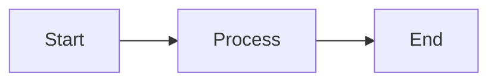

Write diagrams as `mermaid` fenced code blocks or with the `Mermaid`
component. Diagrams are compiled to SVG at build time by
[Ondine](https://ondine.sh), so pages ship static SVG and no diagram renderer
runs in the browser. The raw definition stays in the markup for search
indexing, and a definition that fails to compile shows its source with an
error, and logs a warning during the build.



````md

````

## Component usage

<Mermaid chart="flowchart LR
  A --> B" title="Minimal example" />

```tsx
<Mermaid chart="flowchart LR
  A --> B" title="Minimal example" />
```

The diagram definition can also go in children:

<Mermaid>
flowchart TD
  Top --> Bottom
</Mermaid>

```tsx
<Mermaid>
  flowchart TD
    Top --> Bottom
</Mermaid>
```

See the [Mermaid documentation](https://mermaid.js.org/intro/) for the full
syntax, and [Ondine's diagram list](https://ondine.sh) for the supported
types: flowcharts, sequence, class, state, ER, Gantt, pie, mindmaps, and more.

## Dynamic charts

Definitions written directly in the page (a fence, `chart="..."`,
``chart={`...`}``, or children) are compiled at build time. A chart that is
only known at runtime, such as `chart={someVariable}`, is compiled in the
browser instead, with Ondine's WebAssembly compiler loaded on demand.

## Theming

Diagrams take their colors from the site theme and switch with dark mode
without re-rendering. To restyle them, override Ondine's CSS variables in your
stylesheet:

```css
.ondine {
  --ondine-accent: #7c3aed;
  --ondine-radius: 8px;
  --ondine-stroke: 2px;
}
```

Keep `--ondine-font` monospace: Ondine sizes labels for a monospace font.
See [Ondine's theming guide](https://ondine.sh/docs/guides/theming) for every variable.

## Properties

<PropertiesTable>
<PropertiesTable.Row name="chart" type="string">
  Diagram definition. Defaults to the string children.
</PropertiesTable.Row>

<PropertiesTable.Row name="title" type="ReactNode">
  Optional caption above the diagram.
</PropertiesTable.Row>

<PropertiesTable.Row name="actions" type="boolean" default="true">
  Show zoom and reset controls.
</PropertiesTable.Row>

<PropertiesTable.Row name="placement" type="'top-left' | 'top-right' | 'bottom-left' | 'bottom-right'" default="'bottom-right'">
  Corner for the controls. Fences accept `placement="top-left"` in the info string.
</PropertiesTable.Row>

<PropertiesTable.Row name="children" type="ReactNode">
  Diagram definition when `chart` is omitted.
</PropertiesTable.Row>
</PropertiesTable>
