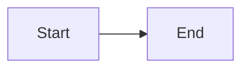

export const dynamicChart = ['flowchart LR', '  Runtime --> Only'].join('\n');



<Mermaid chart="flowchart LR
  AttrA --> AttrB" />

<Mermaid chart={`sequenceDiagram
  Alice->>Bob: TemplateHello`} />

<Mermaid>
flowchart TD
  ChildTop --> ChildBottom
</Mermaid>

<Mermaid chart={dynamicChart} />

```mermaid
flowchart LR
  Broken -->
```
